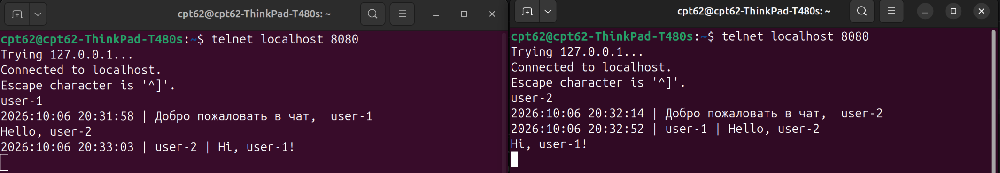

Стек технологий: `Java 17`, `Maven`, `Junit 5.13.4`;
***

## **Сервер**

### **Сервер**. Проблемные моменты.

- Поиск best practice для получения настроек сервера;
- Поиск архитектурного решения работы сервера;

### **Сервер**. Реализация.

1) Класс сервер инкапсулирует экземпляр класса `ServerSocket`;
2) Аргументы `ServerSocket`, согласно требованиям извлекаются из файла. Файл размещен в каталоге `resources` сборщика
   `Maven`. Для получения ресурсов реализован приватный метод `getPropertiesFromConfigFile`, возвращающий экземпляр
   класса `Properties`, несущий в себе настройки сервера (host, port, backlog);
3) Серверный класс реализует паттерн - потокобезопасный `Singleton`. Приватный конструктор инициализирует поля класса
   `Server`, а именно:
    - **private static volatile Server server** - условие реализации `Singleton`. При необходимости именно этот объект
      инициализирется или при существовании возвращается методом `getInstance`.
    - **private volatile boolean isRunning** - проверяется потоком на предмет работы/остановки сервера. Если флаг -
      `true`, сервер работат, раздает задачи `executorService`, который в свою очередь запускает клиентский обработчик.
      Флаг `false` - остановка сервера;
    - **private ConcurrentHashMap<String, ClientHandler>** concurrentHashMap - потокобезопасная карта клиентов и их
      обработчиков;
    - **private ExecutorService executorService** - пул потоков, выделил 5 ниток (Да, хардкод, но условием не
      оговорено);
    - **private Logger logger** - о логировании ниже в описании.
4) Работа сервера осуществляется путем вызова метода `startServer()`, который в потоке принимает подключения сокетов и
   делегирует их обслуживание обработчику `ClientHandler`, выделяя ресурс из пула. Про работу ClientHandler - ниже.
5) Остановка сервера осуществляется вызовом метода stop();
6) Запуск сервера осуществляется созданием экземпляра и вызовом метода `startServer` в отдельном потоке

***

## **Клиент**

### **Клиент**. Проблемные моменты.

- Путаница с IO потоками. Обращался к пройденной теории, хотел обойти необходимость использования двух input потоков.

### **Клиент**. Реализация.

1) Как и класс `Server`, получает настройки из каталога `resources`;
2) Клиент - это точка входа. Объект, который инициализирует сокет, и создает экземпляры потоков:
    - `private BufferedReader console` - обрабатывает поток ввода с клавиатуры;
    - `private BufferedReader br` - принимает поток от `ClientHandler`;
    - `private PrintWriter pw` - выходной поток, отправляет клиентский ввод с клавиатуры (оборачивает собой console);
3) Двигатель объектов класса `Client` - метод start(). До поточной обработки IO-потоков, отправляем свой `никнейм`
   сервреру. Треды:
    - Thread thread - тред, который обрабатывает input поток (лоавит сообщения от сервера);
    - Основной thread - тред, который отправляет серверу ввод с клавиатуры;
4) Запуск клиента осущетвляется путем вызова new Client(String name), где name - введенная строка из объекта scanner и
   вызовом метода start() в потоке;

***

## **Обработчик - ClientHandler**

"Рабочая лошадка" проекта. Именно здесь осуществляется обслуживание клиентов.

### **Обработчик**. Проблемные моменты.

Здесь нашел те самые три сосны, вокруг коротых и путался.

### **Обработчик**. Реализация.

1) Объект `ClientHandler` инициализируется в потоке серверного класса, после вызова метода accept() (блокирующая
   операция класса Server, ожидающая сокет подключения). Инициалиация обработчика требует:
    - Объект socket;
    - ConcurrentHashMap<String, ClientHandler> - данная карта это ссылка на экземпляр карты сервера, которую хранит
      каждый обраотчик. Благодаря этому созданы условия бродкастовой рассылки сообшений чата клиентам;
    - Объект logger - ссылка на logger сервера;
2) При получении сообщения "/exit" от клиента, инициируется отключение данного клиента от сервера;

***

## **Logger**

Обратился к теории, так как в рамках курса отсутствует теоретическая/практическая информация. Есть готовые решения по
логировнию событий работы проекта, такие как SLF4J, Logback, Log4j.

### **Logger**. Проблемные моменты.

- Надеюсь не будет являться дурным тоном, то, что написал логгер самостоятельно. Таким образом, я решил закрепить
  полученные теоретические знания на практике + получил дополнительные знания;
- Записывать каждое логируемое событие файла - тяжеловесная операция. Необходимо найти компромисс между
  производительностью и сохранностью данных;
- Выбор коллеции для работы логгера. Нужна коллекция, которая не блокирует поток и быстро работает с
  Concurrency;

### **Logger**. Реализация.

1) Для работы с потоком сообщений сделан выбор в сторону потокобезопасной коллекция `ConcurrentLinkedQueue` (далее -
   очередь). Плюсы - быстрота, сохраняет порядок добавленных элементов, не блокирует поток при вызове. Особенность:
   безразмерна, что стоит учитывать во избежание переполнения стека;
2) События записываются в очередь, но с некоторой оговоркой:
    1. Так как вызов метода `size()` очереди асимптотически оценивается как `O(n)`, количество записанных сообщений
       считается атомарно и хранися в `AtomicInteger`;
    2. Когда количество записей в очереди достигает 100 или последняя запись в коллекция не обновлялась новыми записями
       более 5 секунд назад, то очередь отправляет свои элементы в буфер, начиная с головы;
    3. Буфером выступает `List<String>`, который отдельной операцией (метод `writeToFile`) пишет события в файл
       `/logs/chat.txt`;
3) Запуск логгера осуществляется методом `startLogger`(), который активирутеся при создании экземпляра.

***

# **Тестирование**

## Интеграционное тестирование (проверка работы моего протокола - протокола прикладного уровня)

1) Запускаем сервер;
2) В `bash` (или в средстве в зависимости от операционной системы), используя команду `telnet localhost 8080`,
   осуществляем подключение к серверу и проверяем работоспособность отправки/приема сообщений, согласно требованиям
   курсовой:

## Unit тестирование

### Реализация

1) В качестве платформы для тестов, используется - Junit 5.13.4;
2) Добавлен unit-test: shouldReturnValidProperties(), проверка получения настроек сервера;
3) Добавлен unit-test: shouldWriteToLogFile() проверка записи логово в chat.txt;